**NeoRixium** is a lightweight, bloat-free Linux distro based on Arch, made for everyday use. The operating system's original name is **RixiumOS**. It is developed by **The NeoRixium Project**, often shortened to **Neo**.

## Built on Arch Linux™

NeoRixium runs on Arch Linux™ under the hood. Rolling release means your system stays up to date — no big version jumps and no reinstalls.

## What is nrx?

Arch Linux gives you pacman — a powerful tool, but one that works with Arch packages. If you need a package that is only available as a `.deb` or `.rpm`, or you do not want to learn several package managers, it can be difficult to know which tool to use.

**nrx** is NeoRixium's answer: one command-line tool that works with pacman and, optionally, other package systems. It gives you one interface, no matter which package system a package comes from.

### How it works

nrx does not replace pacman — it sends your command to it.

```
You type:  sudo nrx install firefox
nrx does:  pacman -S firefox
```

Under the hood, nrx uses **backends** — small drivers, one for each package system. Each backend supports the same basic actions: `install`, `remove`, `search`, `update`, `upgrade`, and `info`. Pacman is always included as the native backend. Other backends, such as Debian/Ubuntu `.deb` support, are optional.

If you do not choose a backend, nrx uses pacman by default:

```
sudo nrx install firefox
     ↓ same as ↓
sudo nrx --pacman install firefox
```

You can also choose a backend yourself, including one that is not native to Arch:

```
sudo nrx --pacman install firefox
sudo nrx --apt install some-package
```

### Foreign packages

nrx can inspect and install packages from other systems, such as `.deb` files, without letting them interfere with your native Arch system. Before installing, nrx shows what the package contains — its files, dependencies, and any install scripts — so you know what you are agreeing to.

### System updates, too

nrx is not just a package manager wrapper — it is also how NeoRixium gets updated. It checks for new NeoRixium releases and shows what has changed. Checking for an update, downloading it, and installing it are separate steps. Nothing is installed without your approval.

### Why it exists

The goal is not to hide Linux's complexity. It is to save you from learning several tools to do the same basic tasks. You can still use pacman directly at any time; nrx is a convenient option, not something you have to use.

---

**NeoRixium** currently offers two desktop environment editions:

-  **Neodymium (XFCE)** – Fast and light, with essential apps and Firefox. It also works well on older hardware.
-  **Neosilicium (KDE Plasma)** – A customizable desktop with KDE's own app suite. It is not bloat-free by nature, but it has been trimmed down as much as possible.

Both editions run on the same Arch-based core. Different desktop, same system.

## These system builds are currently in development and not yet available.

---

# NeoRixium Terms and Conditions

Welcome to NeoRixium! By using, downloading, or sharing NeoRixium, you agree to these terms:

## 1. License

NeoRixium is licensed under the **GNU General Public License v3 (GPLv3)**. You may use, change, and share the software under the terms of this license.

## 2. Usage

- NeoRixium is provided **as is**. The developers are not responsible for damage, data loss, or other problems caused by using the software.
- You may make changes to NeoRixium or build your own distribution based on it.

## 3. Logos and Images

- You may use NeoRixium logos and images for **personal use**, such as wallpapers or decoration.
- You may not use NeoRixium logos, images, or branding for **commercial purposes** without permission.
- You may change the logos for personal, non-commercial projects.

## 4. No Warranty

NeoRixium comes without any warranty. The developer makes no promises about how well it works, its stability, or whether it will work with your hardware. Use it at your own risk.

## 5. Intellectual Property

- The NeoRixium name and logos belong to **The NeoRixium Project**.
- You may mention NeoRixium in non-commercial projects.

## 6. Updates and Support

- NeoRixium may provide updates and new ISO releases.
- Support comes from the community. Official technical support is not guaranteed.

## 7. Changes to These Terms

The NeoRixium Project may update these terms. If you continue to use NeoRixium, you accept the changes.

---

# NeoRixium Privacy Policy

Your privacy is important to The NeoRixium Project. This policy explains what information is collected and how it is used.

## 1. Information Collection

- NeoRixium **does not collect personal data**.
- You do not need to register or provide personal information to download ISOs or visit the website.

## 2. Third-Party Services

- NeoRixium may link to other services, such as GitHub or Netlify, for downloads or contributions.
- Those services' privacy policies apply when you use them.

## 3. Your Rights

Since no personal data is collected, there is no stored personal data for you to ask us to delete.

## 4. Changes to This Policy

This Privacy Policy may change over time. If you continue to use NeoRixium or the website, you accept any updates.

---

# Trademark Policy

Last updated: 2026

## NeoRixium Name and Logo

- The NeoRixium name and logos belong to **The NeoRixium Project**. You may freely mention the NeoRixium name in non-commercial contexts. You may not use the name or logo to suggest official approval or support without permission.

## Arch Linux™

- NeoRixium is based on Arch Linux™. The Arch Linux name and logo are trademarks of Judd Vinet and Aaron Griffin. NeoRixium is an independent project. It is not affiliated with, approved by, or sponsored by the Arch Linux project.
- The Arch Linux™ name is used here only to show that NeoRixium is based on Arch Linux, as allowed by Arch Linux's trademark policy.

## Firefox

Firefox is a trademark of the Mozilla Foundation. NeoRixium includes Firefox as the default browser in its editions. This does not mean Mozilla is connected with or supports NeoRixium.

## KDE Plasma

KDE and the KDE logo are registered trademarks of KDE e.V. The NeoRixium Neosilicium edition is built on KDE Plasma. This does not mean KDE e.V. is connected with or supports NeoRixium.

## XFCE

XFCE is a trademark of its project. NeoRixium uses XFCE in its Neodymium edition, but this does not mean there is an official connection with the XFCE project.

## Other Trademarks

All other trademarks, product names, and company names mentioned here belong to their respective owners.
